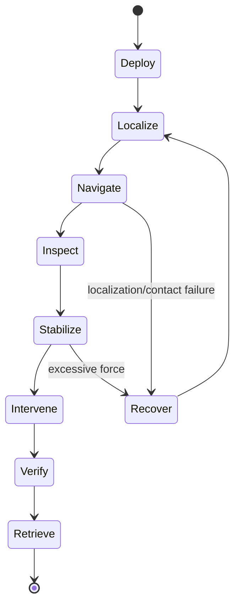

# 4. Surgical applications and task decomposition

Magnetic actuation becomes useful only when it is tied to a procedural task and observable clinical state. The same EPM–IPM model leads to different design priorities in the colon, vascular system, peritoneal cavity, or heart.

## 4.1 Capsule endoscopy and endoluminal intervention

### Task sequence

For a capsule, the external magnet may need to perform four physically different jobs:

- produce torque for heading or rolling;
- produce gradient force for translation, lifting, or wall-contact regulation;
- compensate gravity/tether forces;
- maintain a stable pose for imaging, biopsy, injection, or therapy.

The 2019 levitation paper is especially useful because it treats internal motion as part of the wrench dynamics. A static inverse map can command the right wrench at one instant but fail as the capsule moves through the nonuniform field.

### State and measurement requirements

Useful state variables include capsule position, observable orientation, tether shape/tension, contact state, image quality, and localization covariance. External camera tracking is acceptable for a benchtop derivation but not evidence of clinical observability in opaque anatomy. Endoscopy, fluoroscopy, ultrasound, magnetic localization, or a fused method must eventually replace it.

## 4.2 Laparoscopic magnetic anchoring and retraction

In magnetic anchoring and guidance systems, an internal unit couples to an external magnet through the abdominal wall. Surgical benefits can include fewer rigid instrument shafts, improved camera placement, and intracorporeal retraction without an extra port.

Model the magnetic anchor together with contact:

\[
\mathbf F_m+\mathbf F_c+\mathbf F_g=\mathbf 0,
\]

where \(\mathbf F_c\) is the distributed tissue contact force. A stable magnetic equilibrium is not automatically a safe tissue equilibrium. The control target should include pressure or a defensible proxy, not just pose.

A practical operating envelope is

\[
F_{\text{disturbance,max}}<F_{\text{tangential hold}}
\quad\text{and}\quad
p_{\text{contact}}<p_{\text{injury threshold}},
\]

with uncertainty margins for wall thickness, insufflation pressure, respiration, and magnet misalignment.

## 4.3 Magnetic catheters and guidewires

A distal IPM or distributed magnetic material converts field into bending torque. For a continuum catheter with generalized shape \(\mathbf s\),

\[
K(\mathbf s-\mathbf s_0)+D_s\dot{\mathbf s}
=J_s^T\mathbf w_m+\mathbf f_{\text{contact}}.
\]

The control objective may be tip pose, full-body shape, contact force, or passage through an anatomical lumen. Tip-only control can hide dangerous shaft contact. Magnetic catheter papers should therefore be read for:

- magnet placement and magnetization direction;
- bending/torsion model and boundary conditions;
- localization of the tip versus the complete centerline;
- force/shape observability;
- compatibility with guidewire insertion and clinician input;
- hysteresis, friction, and vessel-wall contact validation.

Edelmann *et al.* provide a central continuum-device treatment; the patient-specific catheter literature adds anatomy-aware design, while dual-EPM and ultrasound-guidance papers address actuation and observability.

## 4.4 Endovascular millirobots and microrobots

At vascular scale, magnetic force competes with drag and wall interactions:

\[
m\dot{\mathbf v}
=\mathbf F_m+\mathbf F_d+\mathbf F_g+\mathbf F_c,
\qquad
\mathbf F_d\approx-6\pi\eta a(\mathbf v-\mathbf v_f)
\]

for a spherical low-Reynolds-number approximation. Vessel flow is pulsatile and geometry varies; the controller should distinguish desired axial motion from cross-stream wall impact.

Clinically relevant validation progresses from a static channel to pulsatile patient-derived phantoms, ex vivo tissue, acute animal models, and survival studies. The 2025 *Science* clinically ready microrobot program is important because it addresses the whole therapeutic workflow rather than locomotion alone.

## 4.5 Ferromagnetic soft continuum robots

Distributed magnetic domains allow programmed deformation:

\[
U_m=-\int_V\mathbf M(\mathbf X)\cdot\mathbf B(\mathbf x(\mathbf X))\,dV.
\]

Shape results from minimizing magnetic plus elastic and gravitational energy, subject to contact. This enables crawling, rolling, grasping, and shape change, but complicates inverse control: the robot is a deformable body, not a single dipole.

For surgical use, distinguish:

- hard-magnetic composites with programmed remanence;
- soft-magnetic bodies magnetized by the applied field;
- discrete embedded permanent magnets;
- magnetically filled hydrogels or elastomers.

Each choice changes hysteresis, residual magnetization, fabrication repeatability, biocompatibility, imaging artifact, and model form.

## 4.6 A reusable surgical-paper dissection template

For every paper, record evidence under the following headings:

| Layer | Questions |
|---|---|
| Clinical task | What procedure, target anatomy, and failure condition are claimed? |
| Robot | Size, material, magnetization, tether, payload, retrieval route? |
| Actuator | Permanent magnet, coil, array, MRI; geometry, strength, workspace, heat? |
| Model | Dipole, finite magnet, FEM, Cosserat, drag, contact, tissue? |
| Sensing | Which state is directly measured; accuracy, rate, latency, occlusion? |
| Controller | Input/output, feedback law, constraints, stability or robustness evidence? |
| Planning | Patient anatomy, actuator collision, field transients, recovery paths? |
| Validation | Sample size, controls, phantom/ex vivo/in vivo/human, quantitative metrics? |
| Translation | Sterility, imaging, emergency stop, workflow, regulatory/manufacturing issues? |
| Reuse | Which equation, data, benchmark, or code can be reproduced? |

This structure prevents a long list of paper summaries from replacing an actual system-level comparison.
