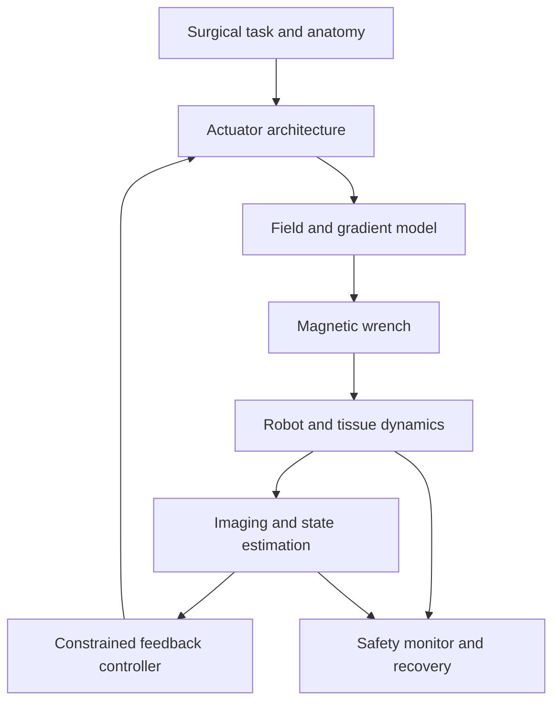

# Magnetic Actuation for Surgical Robotics

An executable, reference-first notebook on magnetic actuation for minimally invasive surgery, laparoscopic robotics, capsule endoscopy, magnetic catheters, and endovascular microrobots.

The repository starts from Appendix A of Pittiglio *et al.* (2019), derives the field, force, torque, wrench, and wrench-rate Jacobians from first principles, and then connects those equations to actuator selection, robot kinematics, feedback control, trajectory planning, calibration, and surgical safety.

> **Scope.** This is an engineering study resource, not clinical guidance. Equations describe ideal magnetic interactions unless a section explicitly introduces calibration, anatomical contact, imaging, thermal, or safety constraints.

## What is inside

| Path | Purpose |
|---|---|
| [`docs/01_fundamentals.md`](docs/01_fundamentals.md) | Magnetostatics, dipole fields, energy, force, torque, scaling, and units |
| [`docs/02_epm_ipm_derivation.md`](docs/02_epm_ipm_derivation.md) | Line-by-line reconstruction of the EPM–IPM appendix and its Jacobians |
| [`docs/03_actuation_architectures.md`](docs/03_actuation_architectures.md) | Single/dual permanent magnets, rotating arrays, coils, MRI, and magnetic anchoring |
| [`docs/04_surgical_applications.md`](docs/04_surgical_applications.md) | Capsule, laparoscopic, catheter, endovascular, and soft-continuum use cases |
| [`docs/05_control_planning.md`](docs/05_control_planning.md) | Inverse actuation, damping, null spaces, optimization, NMPC, and hybrid planning |
| [`docs/06_calibration_validation_safety.md`](docs/06_calibration_validation_safety.md) | Calibration, model validity, benchmarks, failure modes, and clinical constraints |
| [`docs/07_paper_to_equation_map.md`](docs/07_paper_to_equation_map.md) | Which textbook or journal paper supports each equation and design decision |
| [`docs/08_reading_roadmap.md`](docs/08_reading_roadmap.md) | Staged textbook and paper reading plan |
| [`notebooks/`](notebooks/) | Executable derivations, numerical checks, and scaling studies |
| [`src/`](src/) | Reusable magnetic-field, wrench, and Jacobian code |
| [`tests/`](tests/) | Physics invariants and finite-difference regression tests |
| [`references/references.bib`](references/references.bib) | BibTeX library with DOI or official links |

## The system view



The important idea is that a magnetic surgical robot is not just a magnet. It is a coupled **actuator–field–robot–anatomy–imaging–controller** system. A mathematically valid wrench can still be clinically unusable if the external robot collides with the patient, the field corrupts sensing, the capsule presses on tissue, or localization uncertainty is ignored.

## Source of the supplied appendix

The supplied text is Appendix A of:

> G. Pittiglio, L. Barducci, J. W. Martin, J. C. Norton, C. A. Avizzano, K. L. Obstein, and P. Valdastri, “Magnetic Levitation for Soft-Tethered Capsule Colonoscopy Actuated With a Single Permanent Magnet: A Dynamic Control Approach,” *IEEE Robotics and Automation Letters*, 4(2), 1224–1231, 2019. [doi:10.1109/LRA.2019.2894907](https://doi.org/10.1109/LRA.2019.2894907).

This repository preserves the paper's EPM/IPM names:

- **EPM:** external permanent magnet, mounted on a robotic manipulator.
- **IPM:** internal permanent magnet, embedded in the surgical device.
- **EE:** external robot end effector, assumed coincident with the EPM pose in the paper.
- **magnetic wrench:** stacked force and torque, \(\mathbf w_m=[\mathbf F_m^\top\;\boldsymbol\tau_m^\top]^\top\in\mathbb R^6\).

The paper denotes the stacked wrench by \(\tau_m\), even though its first three components are force. Here, \(\mathbf w_m\) is used when ambiguity matters.

## Important source check

Two issues should be handled explicitly before copying the appendix into software:

1. The printed closed-form force appears to use \(\hat{\mathbf m}_I^\top Z\hat{\mathbf m}_I\) in a scalar cross term. The standard dipole–dipole result uses \(\hat{\mathbf m}_I^\top Z\hat{\mathbf m}_E\). Notebook 01 compares both expressions against the numerical gradient of magnetic potential energy.
2. The sign of the IPM-side wrench Jacobian depends on whether the relative vector is defined from EPM to IPM or from IPM to EPM, and on the angular-velocity convention. Notebook 02 checks every block by finite differences instead of relying on a memorized leading minus sign.

These checks do not change the contribution of the source paper; they make its compact notation safe to implement.

## Quick start

```bash
python -m venv .venv
source .venv/bin/activate
pip install -r requirements.txt
pytest -q
jupyter lab
```

Build the browsable documentation with:

```bash
mkdocs serve
```

## Recommended learning order

1. Read the [fundamentals](docs/01_fundamentals.md) and run Notebook 01.
2. Work through the [EPM–IPM derivation](docs/02_epm_ipm_derivation.md) and Notebook 02.
3. Compare [actuation architectures](docs/03_actuation_architectures.md) before selecting hardware.
4. Choose the closest [surgical application](docs/04_surgical_applications.md).
5. Add inverse actuation and constraints from [control and planning](docs/05_control_planning.md).
6. Define the validation matrix in [calibration and safety](docs/06_calibration_validation_safety.md) before claiming autonomy or clinical readiness.

## Citation and reuse

Original code and prose in this repository are MIT licensed. Equations are independently derived and linked to their sources. No publisher PDF is redistributed. Cite the primary paper for any method you adopt; use [`CITATION.cff`](CITATION.cff) only to cite this learning artifact itself.
